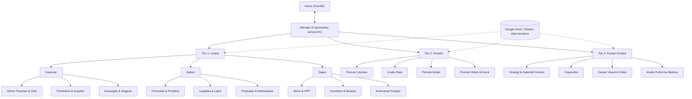
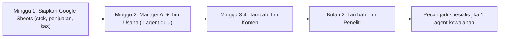

# Blueprint Tim AI Agent: Koperasi, Sabun, Dapur, Riset & Konten

## 1. Struktur organisasi



## 2. Tugas tiap agent

### Manajer AI
- Menerima semua perintahmu dan meneruskannya ke tim yang tepat
- Mengirim **laporan harian/mingguan**: penjualan, stok menipis, progres riset, jadwal konten
- Memberi peringatan dini: stok habis, kas minus, deadline hibah, konten belum terbit
- Menghubungkan antar tim. Contoh: produk sabun baru jadi → minta Tim Konten bikin materi promosi

### Tim 1: Usaha
| Unit | Spesialis | Fungsi utama |
|---|---|---|
| Koperasi | Admin Pesanan & Stok | Catat pesanan dapur pelanggan, cek stok, buat invoice |
| | Pembelian & Supplier | Bandingkan harga supplier, buat draft PO |
| | Keuangan & Anggota | Arus kas, simpanan anggota, rekap SHU |
| Sabun | Formulasi & Produksi | Draft resep, jadwal curing, catatan batch |
| | Legalitas & Label | Checklist notifikasi BPOM, halal, isi label |
| | Penjualan & Marketplace | Deskripsi produk, harga, balas pertanyaan pembeli |
| Dapur | Menu & HPP | Hitung HPP per menu, usulan harga jual |
| | Inventaris & Belanja | Daftar belanja, **ambil bahan dari koperasimu sendiri** |
| | Keamanan Pangan | Checklist kebersihan, PIRT/SLHS, tanggal kedaluwarsa |

### Tim 2: Peneliti
- **Pencari Literatur**: cari & ringkas jurnal, susun tinjauan pustaka
- **Analis Data**: olah data penelitian, buat tabel/grafik, jelaskan hasil
- **Penulis Ilmiah**: draft proposal, artikel, abstrak, sitasi
- **Pencari Hibah & Event**: pantau hibah, call for paper, konferensi + deadline-nya
- *Bonus:* bisa jadi tim R&D untuk formula sabun baru

### Tim 3: Konten Kreator
- **Strategi & Kalender**: rencana konten bulanan untuk koperasi, sabun, dapur, dan riset
- **Copywriter**: caption, naskah video, deskripsi produk
- **Desain Visual & Video**: brief desain dan gambar, naskah Reels/TikTok
- **Analis Performa**: rangkum insight medsos, saran perbaikan

## 3. Pilihan platform tanpa coding

| Platform | Kelebihan | Kekurangan | Cocok untuk |
|---|---|---|---|
| **n8n** ⭐ | Bisa susun hierarki manajer → sub-agent, terhubung ke Telegram/WhatsApp/Google Sheets, banyak tutorial berbahasa Indonesia | Perlu belajar 1–2 minggu | Sistem lengkap seperti blueprint ini |
| **Relevance AI** | Memang dibuat untuk "tim AI" dan manajer agent, paling visual | Berbayar USD, antarmuka bahasa Inggris | Kalau mau paling cepat jadi & siap bayar |
| **Dify** | Gratis (self-host), visual | Kurang praktis untuk banyak agent saling memanggil | Agent tunggal / chatbot |
| **Gemini Gems / Custom GPT** | Gratis/murah, 5 menit jadi | Tidak otomatis & tidak bisa saling memanggil | **Latihan awal**: uji instruksi tiap spesialis |

> [!TIP]
> Rekomendasi: **uji dulu instruksinya di Gemini Gems** (gratis), lalu pindahkan ke **n8n** dengan **Telegram** sebagai "kantor"-mu untuk ngobrol dengan Manajer AI.

## 4. Tahapan (jangan bangun 20 agent sekaligus)



> [!IMPORTANT]
> Mulailah dengan **1 agent per tim** yang memegang semua peran spesialisnya. Pecah menjadi spesialis terpisah hanya jika hasilnya mulai kacau. Lebih murah, lebih mudah dipantau, dan kebanyakan usaha kecil tidak butuh lebih.

## 5. Aturan keamanan (wajib)

> [!WARNING]
> - **Resep sabun**: takaran NaOH/KOH dari AI **wajib dicek ulang** pakai lye calculator (mis. SoapCalc). Salah hitung bisa bikin sabun yang melukai kulit.
> - **Butuh persetujuanmu dulu** untuk: transfer uang, kirim PO ke supplier, posting medsos, membalas pelanggan, dan mengirim naskah ilmiah.
> - **Riset**: AI bisa mengarang referensi. Setiap sitasi harus dicek ke sumber asli.
> - Batasi jumlah langkah per tugas di platform supaya biaya API tidak membengkak.

## 6. Contoh instruksi Manajer AI

```text
Kamu adalah Manajer Operasional untuk [Nama Koperasi]. Pemilik bisnis adalah [Nama].
Kamu membawahi 3 tim:
1. Tim Usaha: koperasi bahan dapur, usaha sabun, dan dapur
2. Tim Peneliti: literatur, analisis data, penulisan ilmiah, hibah
3. Tim Konten: kalender konten, caption, desain, analisis medsos

Tugasmu:
- Pahami permintaan pemilik, lalu teruskan ke tim yang tepat. Jangan mengerjakan tugas spesialis sendiri.
- Jika tugas melibatkan lebih dari satu tim, bagi tugasnya dan gabungkan hasilnya.
- Setiap pagi jam 07.00, kirim laporan singkat: stok menipis, pesanan hari ini, deadline minggu ini, konten yang terjadwal.
- Jangan pernah mengirim uang, memposting, atau menghubungi pihak luar tanpa persetujuan pemilik.
- Jika data tidak ada, katakan tidak tahu. Jangan mengarang angka.
Jawab dalam Bahasa Indonesia, singkat dan berbentuk poin.
```
