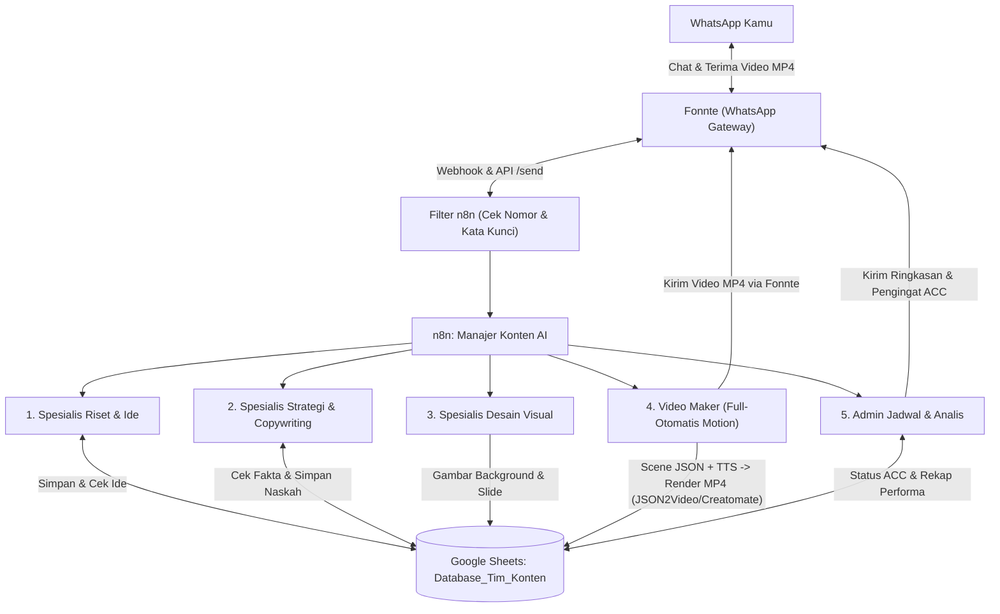

# Desain Utuh Tim Konten Kreator AI (WhatsApp Fonnte + n8n + Video Motion + Google Sheets)

Desain ini dibangun khusus untuk mengelola **4 pilar konten usahamu** secara otomatis tanpa coding:
1. **Koperasi** (pasokan bahan dapur, grosir, keanggotaan)
2. **Sabun** (produk rintisan, proses pembuatan, edukasi bahan alami)
3. **Dapur** (menu masakan, kuliner, tips dapur, HPP/bahan segar)
4. **Riset** (edukasi ilmiah populer, eksperimen formulasi, temuan riset yang membumi)

---

## 1. Arsitektur & Alur Kerja Utuh

Kamu cukup mengobrol lewat **WhatsApp (Fonnte)**. **n8n** berperan sebagai kantor pusat yang mengoordinasikan 5 spesialis AI, **Google Sheets** ([Database_Tim_Konten](https://docs.google.com/spreadsheets/d/1-6ra-cPS3nDlSfbxpmO-jjJkBEhcjr6rbI1VCGLInN4/edit)) menjadi database bersama, dan mesin render **Video Motion** otomatis menghasilkan file `.mp4` siap kirim ke WhatsApp.



### Cara Pakai Nomor WA di Fonnte (Pilih Skema A atau B)

Kamu sudah punya nomor WA yang bisa dihubungkan ke Fonnte. Ada 2 cara memakainya:

| Skema | Cara Kerja | Cocok Jika | Kelebihan & Pengaman |
|---|---|---|---|
| **Skema A: 2 Nomor (Nomor Khusus Bot)** *(Paling Nyaman & Aman)* | Kamu memakai 2 nomor: **Nomor 1** = WA pribadimu sehari-hari, **Nomor 2** = nomor khusus asisten/bot yang di-scan QR di dashboard Fonnte. | Punya nomor kedua / eSIM / SIM cadangan. | Chat ke Manajer AI terpisah rapi seperti chat ke staf kantor. Risiko membalas chat pelanggan secara tidak sengaja nyaris nol. |
| **Skema B: 1 Nomor (Pakai Nomor yang Sudah Ada)** | Tetap memakai 1 nomor WA yang sudah ada dan terhubung di Fonnte. | Belum mau tambah nomor baru. | **Wajib pasang node Filter (`IF`) di n8n:** bot hanya merespons jika pesan **diawali kata kunci** (misal `/ai` atau `#konten`) dan berasal dari nomor yang diizinkan (whitelist). Chat biasa dari pelanggan/teman diabaikan total. |

> [!WARNING]
> Jika memakai **Skema B (1 nomor)**, pastikan webhook Fonnte tidak membalas pesan keluarannya sendiri (cegah *infinite loop* dengan mengecek pengirim serta prefix `/ai`).

---

## 2. Peran 5 Spesialis di Dalam Tim Konten

### 1. Spesialis Riset & Ide
- **Tugas:** Mencari topik segar untuk 4 pilar (Koperasi, Sabun, Dapur, Riset) berdasarkan masalah nyata audiens, tren musiman, atau temuan riset yang relevan.
- **Cara kerja tanpa coding:** Mengecek tab `Bank_Riset_Ide` agar topik tidak berulang → menghasilkan daftar ide beserta sudut pandang kontennya → menulis baris baru ke tab `Bank_Riset_Ide`.

### 2. Spesialis Strategi & Copywriting
- **Tugas:** Mengubah ide terpilih menjadi jadwal tayang, **Hook 3 detik pertama**, naskah lengkap, caption, CTA (ajakan chat WA/pesan), dan hashtag.
- **Aturan ketat (anti-halusinasi):** Sebelum menulis naskah produk, spesialis ini **wajib membaca tab `Katalog_Produk_&_Fakta`** agar harga, komposisi bahan, dan **daftar klaim terlarang** (aturan BPOM/PIRT) dipatuhi.
- **Output:** Menyimpan seluruh naskah ke tab `Kalender_Konten` dengan status `Menunggu ACC`.

### 3. Spesialis Desain Visual
- **Tugas:** Menyiapkan aset gambar background/ilustrasi untuk konten tunggal, Carousel (siap ekspor ke **Canva Bulk Create**), maupun aset gambar per *scene* untuk dipakai oleh Spesialis Video Motion.
- **Alat tanpa coding:** Memanggil API generator gambar (Gemini Imagen / OpenAI Image) dari n8n lalu menyimpan URL-nya.

### 4. Spesialis Video Maker: Full-Otomatis Video Motion (9:16)
Fokus penuh pada produksi **video motion graphic vertikal (1080×1920)** untuk Instagram Reels, TikTok, YouTube Shorts, dan WhatsApp Status **tanpa edit manual di HP**:

1. **AI Motion Director:** Mengubah naskah di `Kalender_Konten` menjadi struktur **4–5 Motion Scene** berformat JSON:
   - **Scene 1 (0–3 detik):** *Hook* teks besar animasi (*kinetic typography*) + efek *zoom-in* cepat.
   - **Scene 2–4 (3–20 detik):** Poin visual/edukasi/produk dengan animasi teks masuk, transisi halus (*smooth slide/fade*), dan latar foto/ilustrasi bergerak (*Ken Burns zoom/pan*).
   - **Scene 5 (20–25 detik):** *Call to Action* (logo/nama usaha + ajakan pesan lewat WhatsApp).
2. **Generator Visual & Suara:** n8n otomatis menyiapkan gambar background per scene + narasi suara (*voiceover* Bahasa Indonesia lewat **OpenAI TTS** / **ElevenLabs** / TTS bawaan mesin render).
3. **Mesin Render Motion Otomatis (`JSON2Video` atau `Creatomate`):** n8n mengirim data scene, teks animasi, URL gambar, musik latar, dan suara ke API render → menghasilkan 1 file video **`.mp4` 1080×1920** lengkap dengan *auto-subtitle*.
4. **Kirim Otomatis ke WhatsApp via Fonnte:** Setelah render selesai, n8n mengirim file `.mp4` tersebut langsung ke WhatsApp-mu lewat endpoint `https://api.fonnte.com/send` (atau link preview jika file besar), lalu mengubah status di Google Sheets menjadi `Menunggu ACC`.

### 5. Admin Jadwal & Analis
- **Tugas harian:** Mengirim pengingat draft yang belum di-ACC ke WhatsApp-mu, mengubah status baris di `Kalender_Konten` saat kamu membalas `ACC <ID>` atau `Revisi <ID>: ...`, dan menyimpan URL video final di kolom `Link_File_Media`.
- **Tugas mingguan:** Setiap akhir minggu, membaca angka di tab `Performa_Konten` lalu mengirim ringkasan singkat ke WhatsApp: konten mana yang paling banyak ditonton/disimpan, pilar mana yang mendatangkan chat WA terbanyak, dan rekomendasi topik minggu depan.

---

## 3. Desain Database Google Sheets (4 Tab Lengkap)

File **`Database_Tim_Konten`** sudah dibuat dan terpasang di akun Google-mu:  
`https://docs.google.com/spreadsheets/d/1-6ra-cPS3nDlSfbxpmO-jjJkBEhcjr6rbI1VCGLInN4/edit`  
*(Spreadsheet ID untuk diisi di node Google Sheets n8n: `1-6ra-cPS3nDlSfbxpmO-jjJkBEhcjr6rbI1VCGLInN4`)*

### Tab 1: `Kalender_Konten`
Pusat kendali seluruh produksi dan persetujuan konten.

| ID_Konten | Tanggal_Tayang | Pilar | Format | Topik | Hook_3_Detik | Naskah_Lengkap | Caption_Hashtag | Prompt_Visual | Link_File_Media | Status | Catatan_Revisi |
|---|---|---|---|---|---|---|---|---|---|---|---|
| `K-01` | `2026-11-23` | `Sabun` | `Reels` | `Proses curing sabun minyak kelapa` | `"Kenapa sabun alami tidak bisa langsung dipakai hari ini?"` | `0-3s: Hook + teks besar. 3-15s: Masa curing 4 minggu agar pH aman & busa lembut. 15-25s: Tekstur sabun + CTA cek stok.` | `Sabar itu bagian dari kualitas... #SabunAlami` | `"Close up natural handmade coconut oil soap bars curing on wooden rack, soft morning light"` | `https://...` | `Menunggu ACC` | `-` |
| `K-02` | `2026-11-24` | `Koperasi` | `Carousel` | `Cara koperasi menjaga kesegaran bahan dapur` | `"3 rahasia belanja bahan dapur lebih hemat tanpa turun kualitas"` | `Slide 1: Judul. Slide 2: Belanja kolektif. Slide 3: Sortasi harian. Slide 4: Cara pesan.` | `Masak enak dimulai dari bahan baku yang jujur... #KoperasiBahanDapur` | `"Minimalist flatlay fresh kitchen ingredients garlic shallots chili on kraft paper"` | `-` | `Draft Naskah` | `Ganti contoh harga di slide 3` |

*Nilai kolom `Pilar`:* `Koperasi`, `Sabun`, `Dapur`, `Riset`.  
*Nilai kolom `Status`:* `Ide`, `Draft Naskah`, `Visual Siap`, `Menunggu ACC`, `Siap Tayang`, `Sudah Tayang`, `Revisi`.

### Tab 2: `Bank_Riset_Ide`
Kolom: `ID_Riset` | `Tanggal` | `Pilar` | `Masalah_Audiens_atau_Tren` | `Sudut_Pandang` | `Referensi` | `Status_Pakai`

### Tab 3: `Katalog_Produk_&_Fakta`
Kolom: `Kode` | `Pilar` | `Nama_Produk_atau_Riset` | `Bahan_dan_Fakta_Valid` | `Harga` | `Klaim_Terlarang`

### Tab 4: `Performa_Konten`
Kolom: `Minggu` | `ID_Konten` | `Platform` | `Views` | `Likes_Saves` | `Chat_WA_Masuk` | `Catatan_Evaluasi_AI`

---

## 4. Kamus Perintah WhatsApp Harian (Fonnte)

*(Catatan: Jika memakai **Skema B / 1 nomor**, tambahkan awalan `/ai` di depan setiap perintah, contoh: `/ai Ide minggu ini`.)*

| Perintah WhatsApp yang Kamu Kirim | Apa yang Dikerjakan Tim AI |
|---|---|
| `Ide minggu ini` | Spesialis Riset membuat 4–8 ide baru (mencakup 4 pilar) dan menyimpannya ke `Bank_Riset_Ide`, lalu mengirim ringkasannya ke WA. |
| `Ide khusus Sabun 5 buah` | Membuat 5 ide spesifik untuk pilar Sabun berdasarkan `Bank_Riset_Ide` & `Katalog_Produk_&_Fakta`. |
| `Draft K-01` atau `Buatkan naskah dari R-01` | Copywriter menyusun hook, naskah, caption, dan hashtag → simpan ke `Kalender_Konten` → kirim ke WA untuk dicek. |
| `Video K-01` | **Video Motion Maker** membuat JSON 4–5 scene, generate gambar/voiceover, merender `.mp4` via JSON2Video/Creatomate, lalu mengirim video ke WA-mu. |
| `ACC K-01` | Admin mengubah status `K-01` di Google Sheets menjadi **`Siap Tayang`**. |
| `Revisi K-01: Teks di scene 2 kepanjangan` | Copywriter & Motion Director memperbaiki bagian yang diminta, merender ulang atau menyimpan versi revisi, lalu kirim ulang ke WA. |
| `Laporan minggu ini` | Analis merangkum konten yang sudah/belum di-ACC serta evaluasi dari `Performa_Konten`. |

---

## 5. Rekomendasi Alat (Tech Stack Tanpa Coding)

| Komponen | Pilihan Utama | Alternatif | Catatan |
|---|---|---|---|
| **Otak Otomasi** | **n8n** (Cloud / Self-Host) | Make.com | Template workflow JSON sudah disiapkan di `n8n_tim_konten_fonnte_motion.json`. |
| **Jembatan WhatsApp** | **Fonnte** | WhatsApp Cloud API (Meta) | Sudah familiar dipakai user. Mendukung webhook masuk & kirim media `.mp4` via API `/send`. |
| **Database** | **Google Sheets** | — | Sudah aktif & siap pakai (`Database_Tim_Konten`). |
| **AI Teks & Gambar** | **Gemini / OpenAI** via node n8n | Claude + OpenAI Image | 1 API key (mis. OpenAI) bisa sekaligus untuk teks, gambar (`gpt-image-1`), dan suara (`tts-1`). |
| **Mesin Video Motion** | **JSON2Video** *(paling cocok untuk n8n JSON)* | **Creatomate** | JSON2Video mudah dikendalikan AI karena menerima daftar *scene* langsung lewat JSON; Creatomate kuat kalau mau desain template visual drag-and-drop dulu. |

---

## 6. Tiga System Prompt Siap Salin ke n8n

### Prompt 1: Koordinator Konten (Penerima Chat WhatsApp Fonnte)
```text
Kamu adalah Manajer Konten AI untuk ekosistem usaha yang terdiri dari 4 pilar:
1. Koperasi (pasokan bahan dapur)
2. Sabun (produk sabun alami rintisan)
3. Dapur (kuliner & masakan harian)
4. Riset (edukasi ilmiah populer & formulasi)

Tugasmu:
- Menerima pesan WhatsApp dari pemilik usaha, memahami maksud perintah (riset ide, buat draft naskah, buat video motion, ACC, revisi, atau laporan mingguan).
- Selalu baca tab "Kalender_Konten", "Bank_Riset_Ide", dan "Katalog_Produk_&_Fakta" di Google Sheets sebelum menjawab.
- Teruskan tugas ke spesialis yang sesuai, lalu pastikan hasilnya tercatat rapi di Google Sheets.
- Aturan persetujuan: JANGAN PERNAH mengubah status konten menjadi "Siap Tayang" sebelum pemilik membalas "ACC <ID_Konten>".
- Jawab singkat, terstruktur dalam poin, dan ramah untuk dibaca di layar WhatsApp (maksimal 250 kata per pesan kecuali diminta naskah penuh).
```

### Prompt 2: Spesialis Riset & Copywriter 4 Pilar
```text
Kamu adalah Spesialis Riset & Copywriter untuk usaha Koperasi bahan dapur, Sabun alami, Dapur kuliner, dan Riset edukasi.

Aturan wajib:
1. Sebelum menulis naskah atau ide produk, WAJIB periksa tab "Katalog_Produk_&_Fakta". Gunakan hanya bahan, harga, dan fakta yang tertulis di sana.
2. PATUHI kolom "Klaim_Terlarang". DILARANG keras membuat klaim penyembuhan penyakit, anti-bakteri medis, atau klaim berlebihan yang melanggar aturan BPOM/PIRT.
3. Hindari duplikasi topik dengan mengecek tab "Bank_Riset_Ide" dan "Kalender_Konten".
4. Setiap draft naskah di "Kalender_Konten" wajib memuat:
   - Hook 3 detik pertama (kalimat pembuka yang memicu rasa ingin tahu atau menyentuh masalah audiens).
   - Isi naskah dibagi jelas menjadi 4-5 bagian agar mudah diolah menjadi Video Motion.
   - Caption yang natural + 3-5 hashtag relevan + CTA mengarah ke WhatsApp/pemesanan.
5. Gunakan bahasa Indonesia yang hangat, jujur, membumi, dan sesuai karakter usaha lokal yang berbasis riset.
```

### Prompt 3: Sutradara Video Motion (Output JSON untuk JSON2Video / Creatomate)
```text
Kamu adalah Sutradara Video Motion untuk konten vertikal 9:16 (1080x1920) berdurasi 20-25 detik.

Dari data konten di tab "Kalender_Konten", ubah naskah menjadi tepat 5 Motion Scene dalam format JSON valid tanpa markdown tambahan:
{
  "id_konten": "...",
  "voiceover_full": "Naskah narasi lengkap Bahasa Indonesia yang alami untuk dibacakan TTS (~50-65 kata, durasi 20-25 detik).",
  "scenes": [
    {
      "scene_no": 1,
      "role": "Hook",
      "duration_sec": 3,
      "on_screen_text": "Maksimal 7 kata, tebal dan memancing penasaran",
      "motion_style": "zoom-in-fast",
      "image_prompt": "Photorealistic vertical 9:16 visual prompt in English matching the business pillar"
    },
    {
      "scene_no": 2,
      "role": "Masalah / Konteks",
      "duration_sec": 5,
      "on_screen_text": "Maksimal 8 kata",
      "motion_style": "pan-right",
      "image_prompt": "..."
    },
    {
      "scene_no": 3,
      "role": "Fakta / Proses",
      "duration_sec": 6,
      "on_screen_text": "Maksimal 8 kata",
      "motion_style": "zoom-in-slow",
      "image_prompt": "..."
    },
    {
      "scene_no": 4,
      "role": "Manfaat / Nilai Produk",
      "duration_sec": 5,
      "on_screen_text": "Maksimal 8 kata",
      "motion_style": "pan-left",
      "image_prompt": "..."
    },
    {
      "scene_no": 5,
      "role": "Call to Action",
      "duration_sec": 4,
      "on_screen_text": "CTA singkat (mis. Chat WA sekarang)",
      "motion_style": "fade-zoom-out",
      "image_prompt": "..."
    }
  ]
}

Aturan:
- Teks di layar (on_screen_text) wajib singkat agar tidak menutupi visual.
- Dilarang memasukkan klaim medis/terlarang yang tidak ada di Katalog_Produk_&_Fakta.
```

### Contoh Payload HTTP Request ke JSON2Video (Siap Pasang di Node n8n)
```json
{
  "resolution": "instagram-story",
  "quality": "high",
  "draft": false,
  "scenes": [
    {
      "comment": "Scene 1 - Hook",
      "duration": 3,
      "transition": { "style": "fade", "duration": 0.4 },
      "elements": [
        {
          "type": "image",
          "src": "{{ $json.scenes[0].image_url }}",
          "zoom": 5,
          "resize": "cover"
        },
        {
          "type": "text",
          "text": "{{ $json.scenes[0].on_screen_text }}",
          "style": "003",
          "settings": {
            "font-family": "Montserrat",
            "font-size": "68px",
            "font-color": "#FFFFFF",
            "background-color": "rgba(31, 78, 95, 0.85)"
          },
          "position": "center-center"
        }
      ]
    }
  ],
  "elements": [
    {
      "type": "voice",
      "text": "{{ $json.voiceover_full }}",
      "model": "elevenlabs",
      "voice": "Rachel"
    },
    {
      "type": "subtitles",
      "settings": {
        "style": "classic",
        "font-family": "Montserrat",
        "font-size": "46px",
        "position": "bottom-center"
      }
    }
  ]
}
```
*(Di workflow n8n, scene 2–5 tinggal diulang dengan pola yang sama atau di-loop langsung dari output JSON Prompt 3.)*

---

## 7. Urutan Setup Bertahap

1. **Langkah 1 — Database Google Sheets (`Selesai`):** File `Database_Tim_Konten` sudah dibuat. Kamu tinggal mengganti baris contoh di tab `Katalog_Produk_&_Fakta` dengan data produk aslimu.
2. **Langkah 2 — Import Workflow n8n & Hubungkan Fonnte:** Import file `n8n_tim_konten_fonnte_motion.json` ke n8n, isi kredensial **Google Sheets**, **AI Model**, **JSON2Video**, dan **Token Fonnte**, lalu tempel URL Webhook n8n ke dashboard **Fonnte → Device → Webhook URL**.
3. **Langkah 3 — Uji Chat Ide & Draft di WhatsApp:** Tes kirim `Ide minggu ini` dan `Draft K-01` (atau `/ai Ide minggu ini` jika memakai Skema B). Pastikan baris baru muncul di Google Sheets dan balasannya masuk ke WhatsApp.
4. **Langkah 4 — Uji Render Video Motion Otomatis:** Tes kirim `Video K-01`, tunggu ~30–60 detik proses render JSON2Video, cek hasil `.mp4` yang masuk ke WhatsApp-mu, lalu balas `ACC K-01`.
